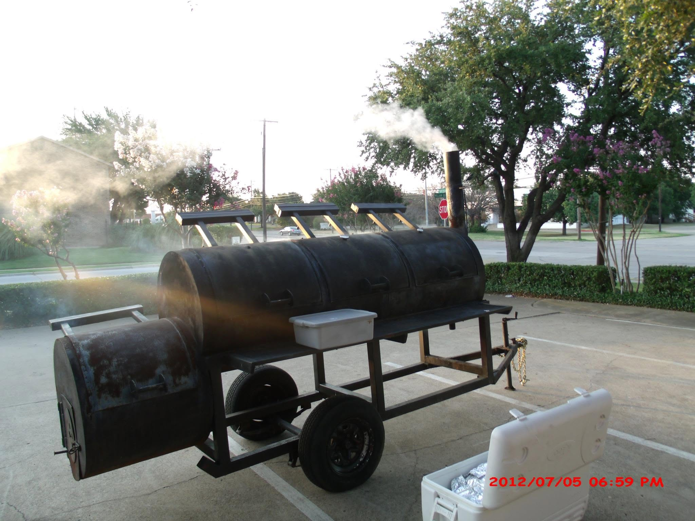

# South East Texas BBQ & Catering



A mobile-first catering website for **South East Texas BBQ & Catering**.

**Live website:** https://westberglabs.github.io/set-bbq-website/

---

## What this project does

Customers can:

- Browse the menu and pricing
- Build a catering request
- Choose quantities and menu options
- Request delivery
- Add special requests
- Request a custom dessert starting at $40
- Submit an order
- Receive a confirmation email
- Receive a PDF copy of the order

When an order is submitted:

1. The business receives the full order by email.
2. The customer receives a confirmation email.
3. The PDF invoice is generated in the browser.
4. The business email's **Reply-To** is set to the customer.
5. The business email also provides the current SMS notification workflow through Verizon email-to-text.

The pages themselves are **static**. The menu, prices, and admin sign-in are backed by Supabase, so menu changes go live without a deploy.

---

## Repository

**GitHub:** https://github.com/WestbergLabs/set-bbq-website

### Branches

| Branch | Purpose |
|---|---|
| `main` | Production / approved live code |
| `development` | Development, testing, and the current GitHub Pages preview |

Keep `main` stable. Make and test major changes on `development`, then merge the approved result into `main`.

---

## Project structure

```text
/
├── index.html              # Home
├── menu.html               # Menu
├── catering.html           # Catering information
├── order.html              # Customer order form
├── contact.html            # Contact information
├── admin.html              # Admin dashboard: menu editor, system status
│
├── data/
│   ├── menu.json           # Reference copy of the menu (live data is in Supabase)
│   └── prices.json         # Reference copy of prices and the delivery fee
│
├── css/
│   └── style.css           # Shared site styling
│
├── js/
│   ├── order.js            # Order form, options, totals
│   ├── admin-menu.js       # Menu editor inside admin.html
│   ├── admin-auth.js       # Supabase admin sign-in
│   ├── menu-store.js       # Loads and saves the Supabase menu row
│   ├── custom-dessert.js   # Custom dessert handling
│   ├── email-order-v2.js   # Email/PDF/order submission
│   ├── emailjs-config.js   # EmailJS configuration
│   ├── site-version.js     # Visible build version
│   └── ...                 # Supporting order/PDF scripts
│
├── images/
│   ├── logo/               # Site logos
│   └── hero/               # Hero imagery
│
├── tools/
│   └── test-options.js     # node tools/test-options.js, order option scenarios
│
└── docs/
    └── EMAILJS_SETUP.md    # EmailJS setup reference
```

There are several small order-related JavaScript files because the order system was built incrementally. **Do not combine, rename, or remove them casually.** Check `order.html` before changing script names or load order.

---

# Changing menu items and prices

The live menu and prices come from the Supabase `site_menu` row, not from the
repository. `data/menu.json` and `data/prices.json` are reference copies only.

Edit everything in the admin dashboard:

**Admin:** https://westberglabs.github.io/set-bbq-website/admin.html

Sign in, then use **Menu & Pricing**. You can change item names, descriptions,
unit wording, base prices, options, the delivery fee, and item order, and add or
delete items. Save Changes publishes to the customer menu and order form
immediately. Item IDs are shown for reference and should stay as they are; search
the JavaScript for an ID before removing an item that has one.

### Options syntax

The Options cell opens a full size editor. One choice per line:

```text
Mild | 0
Spicy | 0
```

The number after `|` is added to the item's base price, so `Regular Cookies | 10`
prices that choice ten dollars above the base.

Start a group with `Group:` on its own line. The **first** group is what the
customer checks; every later group is a follow-up question about the choice they
checked:

```text
Group: Flavor
Blueberry Lemon Drop | 0
Regular Banana Pudding | 0
Group: Cookies [Blueberry Lemon Drop]
No Cookies | 0
Half Cookies | 0
Regular Cookies | 10
Group: Cookies [Regular Banana Pudding]
Regular Cookies | 0
Different Cookies | 0
```

The names in brackets limit a group to those choices, which is how one flavor can
offer different cookie amounts than another. They must match the first group's
names exactly; the editor refuses a name it cannot find. A choice named in no
bracket list is simply ordered without that question.

On the order form each of these choices becomes its own quantity line, so two of
the same flavor can be ordered with different cookie amounts, and the quantities
have to add up to the item quantity.

### Desserts

Customer-facing dessert names intentionally do **not** use unexplained "pan" terminology.

Current special dessert behavior includes:

- Banana Pudding — Full Size
- Banana Pudding — All Biscotti
- Banana Pudding — Half & Half
- Small Mason Jar pudding
- Custom Dessert — Starting at $40

Custom desserts are **starting-price requests**, not guaranteed final prices. Someone will contact the customer to discuss the request and final pricing.

---


# Email system

Email is handled by **EmailJS**. Supabase or another database is **not** involved in sending email.

The site sends:

- **Business order email**
- **Customer confirmation email**

The business order uses the customer's email as **Reply-To**.

The PDF invoice is generated in the browser with PDF-Lib and attached to the emails.

### EmailJS configuration

Website configuration:

```text
js/emailjs-config.js
```

EmailJS templates currently used:

- `set_bbq_business_order`
- `set_bbq_customer_confirm`

The business and customer sends intentionally use their configured services. Do not change the working routing without testing both emails.

See:

```text
docs/EMAILJS_SETUP.md
```

for the setup reference.

### SMS notification (retired)

The old alert used a **business email -> Verizon email-to-text** BCC. It was removed in November 2026 (Verizon ends that gateway on 2027-03-31, and it was not reliable). The **Telegram order alert** below replaces it.

### Telegram order alert

Every order also posts an alert and the invoice PDF to the private **SET BBQ Orders** Telegram channel. This is purely additive: the EmailJS emails are unchanged, and a Telegram failure never blocks or alters them.

**Flow:** `order.html` -> `js/email-order-v2.js` (fire-and-forget POST) -> Cloudflare Worker `worker/index.js` -> Telegram Bot API (`sendMessage`, then `sendDocument` with the PDF).

- **Worker URL:** `alertUrl` in `js/emailjs-config.js`. Empty disables the alert.
- **Worker code:** `worker/` (`index.js`, `wrangler.toml`). It only accepts POSTs from `setxbbqcatering.com` and the `github.io` site, rejects the honeypot field, trims every field, and retries Telegram up to 4 times on errors or rate limits.
- **Secrets** (Cloudflare, never in the repo): `TELEGRAM_BOT_TOKEN` (from @BotFather) and `TELEGRAM_CHAT_ID` (the channel's ID, a negative number).

**Redeploy the Worker** after changing `worker/index.js`:

```powershell
cd worker
npx wrangler login      # first time only
npx wrangler deploy
```

**Change a secret** (for example after rotating the bot token in @BotFather, or to point at a different channel). Setting a secret takes effect immediately, no redeploy needed:

```powershell
cd worker
npx wrangler secret put TELEGRAM_BOT_TOKEN
npx wrangler secret put TELEGRAM_CHAT_ID
```

**Find a chat ID:** add the bot to the channel as an admin, post a message, then open `https://api.telegram.org/bot<TOKEN>/getUpdates` or run `(Invoke-RestMethod "https://api.telegram.org/bot<TOKEN>/getUpdates").result` and read `chat.id`.

**Add a recipient:** share the channel's invite link. They need Telegram notifications turned on for channels (Telegram -> Settings -> Notifications and Sounds -> Channels) and the channel not muted.

**Test the Worker alone** (PowerShell, one line):

```powershell
Invoke-RestMethod -Method Post -Uri https://set-bbq-alerts.4thehalibit.workers.dev -Headers @{Origin="https://setxbbqcatering.com"} -ContentType "application/json" -Body '{"name":"Test","phone":"555-1234","eventName":"Test BBQ","eventDate":"Dec 1","guests":"20","orderNumber":"TEST-1"}'
```

Expect `ok: True` and a message in the channel. A full test order from `order.html` also sends the real business email, so mark it as a test.

**History:** CallMeBot (WhatsApp) was full, and ntfy banners were unreliable on iPhone, so Telegram was chosen.

---

# External services and websites

| Service | Purpose | Website |
|---|---|---|
| **GitHub** | Source code and version control | https://github.com/ |
| **GitHub Pages** | Hosts the production website | https://pages.github.com/ |
| **EmailJS** | Sends business and customer emails | https://www.emailjs.com/ |
| **Cloudflare Workers** | Relays order alerts to Telegram | https://workers.cloudflare.com/ |
| **Telegram** | Order alert channel and invoice PDF | https://telegram.org/ |
| **jsDelivr** | Loads browser libraries | https://www.jsdelivr.com/ |
| **PDF-Lib** | Generates PDF invoices in the browser | https://pdf-lib.js.org/ |

### Email accounts used by the workflow

- **Yahoo** — business/customer email mailbox
- **Gmail** — current sending service used for business-order email routing
- **Verizon** — SMS notification delivery

These are part of the operational workflow; they are not application databases.

---

# Order form

The order form is primarily handled by:

### `js/order.js`

Responsible for:

- Loading menu/pricing data
- Rendering menu categories
- Quantities
- Options
- Split options
- Validation
- Order summary
- Totals

### `js/custom-dessert.js`

Responsible for:

- Custom Dessert UI
- Customer's custom description
- Including the custom request with the order

### `js/email-order-v2.js`

Responsible for:

- Building the order
- Generating the order number
- Building email HTML
- Generating the PDF
- Sending the emails
- Customer confirmation

### PDF

The invoice is generated in the browser using PDF-Lib.

The email and PDF are built from the same order data so quantities, options, item names, and totals stay synchronized.

---

# Testing

For local testing:

```bash
python -m http.server 8000
```

Then open:

```text
http://localhost:8000
```

### Basic production test

Before moving a significant order-form change to `main`, verify:

- Home page
- Menu page
- Catering page
- Contact page
- Order page on desktop
- Order page on mobile
- Empty-order validation
- Quantities
- Menu options
- Brisket options
- Pork belly options
- Wings options
- Baked Beans options
- Banana Pudding All Biscotti
- Banana Pudding Half & Half
- Small Mason Jar
- Custom Dessert
- Delivery fee
- Special requests
- Correct total
- Business email
- Customer confirmation
- PDF invoice
- Business email Reply-To → customer

For a Custom Dessert order, confirm the request appears in the:

- Business email
- Customer email
- PDF

---

# Versioning

The site displays its current build version in the footer.

Version file:

```text
js/site-version.js
```

For meaningful production changes:

1. Update the site version.
2. Check any changed script cache-busting query strings in `order.html`.
3. Test the affected workflow.

The current site build is **v0.1.22**.

---

# Future database

A database is **not currently part of production**.

If a database is added later, it should be treated as a **data layer only**:

```text
Customer
   ↓
Website
   ├── Database → order records
   └── EmailJS → email notifications
                    ↓
                 Verizon
                    ↓
                 SMS alert
```

Do not reintroduce database/email responsibilities into the website unless there is a specific reason to do so.

---

# Future changes

Recommended workflow:

1. Start on `development`.
2. Make the smallest necessary change.
3. Test locally.
4. Test the affected page on mobile and desktop.
5. For order changes, submit a complete test order.
6. Verify business email, customer email, PDF, and SMS alert when applicable.
7. Update the version.
8. Move the approved change to `main`.
9. Keep `development` available for the next change.

**Keep the site simple.** Avoid adding infrastructure unless the business actually needs it.
